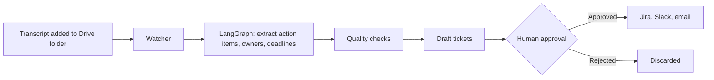

# Meeting Agent

An agent that turns meeting transcripts into Jira-ready tickets, Slack status updates and summary emails, with human approval before anything goes out.

> **Status: in progress (2 of 8 stages built).** The watcher can detect and read transcripts, but the agent doesn't extract action items or send anything yet. No accuracy or time-saving results have been measured so far.

## How it will work



## Progress

| # | Stage | Status |
|---|---|---|
| 1 | Foundation: data formats, settings, SQLite storage | Done |
| 2 | Drive trigger: detect, read and retry transcripts | Built; not yet run against live Google Drive |
| 3 | LangGraph extraction with OpenAI | Not started |
| 4 | Quality checks: duplicates, hallucinations, deadlines | Not started |
| 5 | Human approval page in Streamlit | Not started |
| 6 | Jira, Slack and Gmail outputs, mocks first | Not started |
| 7 | Evaluation on 120 labelled transcripts | Not started |
| 8 | Time-saving measurement, Docker, demo | Not started |

## What works today

- **Transcript detection:** checks a folder on a timer and picks up new or edited files.
- **File formats:** `.txt`, `.docx`, `.vtt` (Teams and Zoom styles) and Google Docs.
- **No repeat runs:** each version of a file is processed once, including across restarts.
- **Failure handling:** unreadable files are marked failed with a reason. Runs that crash or hit a temporary error are retried, up to 3 attempts in total.

## Getting started

You need [uv](https://docs.astral.sh/uv/). Python 3.13 is the required version, and uv can install it for you.

```bash
git clone https://github.com/Srujan641/agents.git
cd agents
uv sync
uv run pytest
```

### Try it without Google credentials

This reads a local folder in place of Drive. Each transcript is only logged for now, and is marked as completed in the database.

```bash
SETTLE_SECONDS=0 DATABASE_PATH=data/demo.db \
  uv run meeting-agent watch --once --local-folder samples/transcripts
```

Run it a second time and nothing is processed again, because those versions are already recorded in `data/demo.db`.

### Use a real Drive folder

1. In Google Cloud, turn on the Drive API and create a service account with a JSON key.
2. Save the key in the project root as `credentials.json`.
3. Share your Drive folder with the service account's email.
4. Run `cp .env.example .env` and set `DRIVE_FOLDER_ID`.
5. Run `uv run meeting-agent watch`.

Only files directly inside the folder are read, not subfolders.

## Configuration

Settings are read from `.env`, and [.env.example](.env.example) lists them all. It also has placeholders for OpenAI, Jira, Slack and Gmail, which the code doesn't use yet. The `.gitignore` file excludes `.env` and credential files, so keep your secrets there.

## Project layout

```text
src/meeting_agent/
  cli.py        command-line entry point
  config.py     settings
  drive.py      Google Drive client and local folder stand-in
  parsers.py    converts each file format to plain text
  schemas.py    data formats for transcripts, action items and tickets
  storage.py    SQLite storage
  watcher.py    polling, retries and failure handling
samples/        real meeting transcripts for testing
scripts/        data import tools
tests/          test suite
```

## Sample data

[samples/transcripts](samples/transcripts) holds 9 meetings converted from [QMSum](https://github.com/Yale-LILY/QMSum) (MIT licence). See [samples/README.md](samples/README.md) for details.
