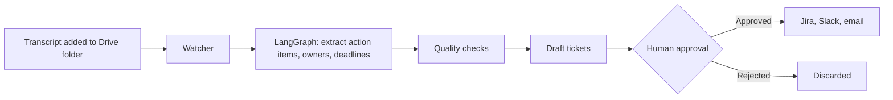

# Meeting Agent

An agent that turns meeting transcripts into Jira-ready tickets, Slack status updates and summary emails, with human approval before anything goes out.

## How it works



## Features

- **Transcript detection:** checks a folder on a timer and picks up new or edited files.
- **File formats:** `.txt`, `.docx`, `.vtt` (Teams and Zoom styles) and Google Docs.
- **No repeat runs:** each version of a file is processed once, including across restarts.
- **Failure handling:** unreadable files are marked failed with a reason. Runs that crash or hit a temporary error are retried, up to 3 attempts in total.
- **Extraction:** finds action items, owners and deadlines, and splits long meetings into chunks.
- **Quality checks:** every item must quote the transcript, duplicates are merged, deadlines are validated, and a second model pass rejects weak items.
- **Human approval:** nothing is sent until a person approves it, and paused runs survive restarts.
- **Cost limit:** any OpenAI call that could cost more than $0.50 is refused before it is sent.
- **Integrations:** delivery goes through small client interfaces, so Jira, Slack, Gmail or other tools can be integrated by implementing one method each.

## Evaluation

Scored on 86 unseen meetings from the [AMI Meeting Corpus](https://groups.inf.ed.ac.uk/ami/corpus/) (CC BY 4.0), most of them role-played product design meetings. Agent tickets were compared with action items written by human annotators.

| Metric | Official test (86 unseen meetings) | Tuning set (21 meetings) |
|---|---|---|
| Tickets drafted | 272 | 63 |
| Tickets matching a human item | 143 | 34 |
| **Precision** | **52.6%** | 54.0% |
| Human items | 220 | 50 |
| Human items found | 130 | 34 |
| **Recall** | **59.1%** | 68.0% |
| **F1** | **55.6%** | 60.2% |
| Total OpenAI cost (upper bound) | $0.31 | $0.08 |
| Most expensive call (upper bound) | $0.004 | $0.003 |

An AI judge decided whether a ticket and a human item described the same task. The human items come from short summaries, so real tasks they omit count as wrong and precision is likely understated. The prompts were tuned only on 21 separate meetings. See `backend/evaluation/`.

## Getting started

You need [uv](https://docs.astral.sh/uv/). Python 3.13 is the required version, and uv can install it for you.

```bash
git clone https://github.com/Srujan641/agents.git
cd agents
uv sync
uv run pytest
```

### Try it without Google credentials

This reads a local folder in place of Drive, and with the default settings nothing leaves your machine except the OpenAI calls. Add `OPENAI_API_KEY` and `OPENAI_MODEL` to `.env` first (`cp .env.example .env`). Each transcript uses paid OpenAI calls, at a fraction of a cent per call for `gpt-6-luna`.

```bash
SETTLE_SECONDS=0 uv run meeting-agent watch --once --local-folder backend/samples/transcripts
uv run streamlit run frontend/app.py --server.address 127.0.0.1
```

Review the drafts on the page at <http://127.0.0.1:8501>. It has no login, so keep it on your own machine.

### Use a real Drive folder

1. In Google Cloud, turn on the Drive API and create a service account with a JSON key.
2. Save the key in the project root as `credentials.json`.
3. Share your Drive folder with the service account's email.
4. Run `cp .env.example .env` and set `DRIVE_FOLDER_ID`.
5. Run `uv run meeting-agent watch`.

Only files directly inside the folder are read, not subfolders.

## Configuration

Settings are read from `.env`, and [.env.example](.env.example) lists them all. It also lists the settings for the Jira, Slack and Gmail integrations. The `.gitignore` file excludes `.env` and credential files, so keep your secrets there.

## Project layout

```text
backend/
  meeting_agent/
    cli.py        command-line entry point
    config.py     settings
    drive.py      Google Drive client and local folder stand-in
    llm.py        OpenAI calls with the per-call cost limit
    outputs.py    Jira, Slack and email client interfaces
    parsers.py    converts each file format to plain text
    pipeline.py   LangGraph workflow
    quality.py    duplicate, hallucination and deadline checks
    schemas.py    data formats for transcripts, action items and tickets
    service.py    connects the parts together
    storage.py    SQLite storage
    watcher.py    polling, retries and failure handling
  samples/        real meeting transcripts for testing
  scripts/        data import tools
  tests/          test suite
  evaluation/     scoring against human-labelled meetings
frontend/
  app.py          Streamlit approval page
database/
  schema.sql      table definitions
.claude/skills/   how-to guides for each part of the project
```

## Sample data

[backend/samples/transcripts](backend/samples/transcripts) holds 9 meetings converted from [QMSum](https://github.com/Yale-LILY/QMSum) (MIT licence). See [backend/samples/README.md](backend/samples/README.md) for details.
